<div align="center">

# APKDetective


**Open and inspect any Android app (`.apk`) from your PC.**

[](LICENSE)
[](https://github.com/gmm96/APKDetective/releases/latest)
[](https://github.com/gmm96/APKDetective/actions/workflows/analyze.yml)


[Download](#download) ·
[Quick start](#quick-start) ·
[Features](#features) ·
[Screenshots](#screenshots) ·
[Architecture](#architecture) ·
[Contributing](#contributing)

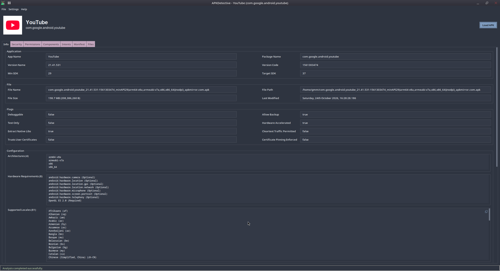
<br><br>
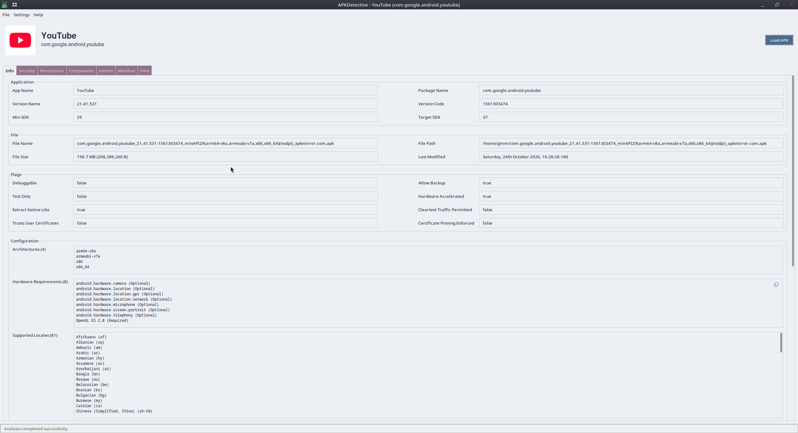

</div>

---

## Table of contents

- [What is APKDetective?](#what-is-apkdetective)
- [Who is it for?](#who-is-it-for)
- [Download](#download)
- [Quick start](#quick-start)
- [Features](#features)
- [Screenshots](#screenshots)
- [New to Android? A 2-minute glossary](#new-to-android-a-2-minute-glossary)
- [Architecture](#architecture)
- [Tech stack](#tech-stack)
- [Running from source](#running-from-source)
- [Building the executables](#building-the-executables)
- [Development](#development)
- [Contributing](#contributing)
- [License](#license)
- [Acknowledgements](#acknowledgements)


## What is APKDetective?

An **APK** is the file Android apps are distributed in (it is what an app store downloads to your phone). It is a
compressed package full of code, images and configuration, and it is **not** meant to be read by humans.

**APKDetective is a desktop application that opens that package and presents everything useful in it as clean,
readable tabs**: the app's name and version, which permissions it asks for, who signed it, which trackers and
libraries it carries, how it can be launched from other apps, the decoded `AndroidManifest.xml`, and every file inside.

It does **not** install, run or modify the app. It only reads it. Nothing is uploaded anywhere: the analysis is
100 % local and works offline.


## Who is it for?

| You are... | APKDetective helps you... |
|---|---|
| **A curious user** | Check what an app asks for (camera? contacts? SMS?) and who made it, before installing it. |
| **A developer** | Verify the final package: SDK range, flags like *debuggable*, signing scheme, size of the code, exported components. |
| **An automation fan** (Tasker, `adb`, MacroDroid...) | Find every action and component you can launch with an *intent*, in one flat table. |
| **A security / privacy reviewer** | Spot dangerous permissions, certificate fingerprints, embedded URLs and known tracker/ad SDKs. |
| **A modder / tinkerer** | Browse and extract any file from inside the APK without unzipping it by hand. |


## Download

Ready-to-run executables (no Python needed) are attached to every
[**GitHub Release**](https://github.com/gmm96/APKDetective/releases/latest):

| Platform | File | How to run |
|---|---|---|
| **Windows** | `APKDetective-windows.exe` | Double-click it. |
| **Linux** | `APKDetective-linux.bin` | `chmod +x APKDetective-linux.bin && ./APKDetective-linux.bin` |
| **macOS** | `APKDetective-macos.bin` | `chmod +x APKDetective-macos.bin && ./APKDetective-macos.bin` |

> Prefer running from the source code? See [Running from source](#running-from-source).


## Quick start

1. **Start** APKDetective. Until an APK is loaded only the **Info** tab is available (and empty); the others unlock once there is something to show.
2. Press **`Ctrl + O`** (or click **Load APK**) and choose an `.apk` file.
3. Wait a moment: the status bar at the bottom shows progress and the other tabs stay locked until the analysis ends.
   If an APK is very large, press **Cancel** (the *Load APK* button turns into it while an analysis runs) to stop it.
4. **Browse the tabs.** Everything is read-only and safe to explore.
5. Hover over any value to reveal a small **copy icon** and copy it to the clipboard.


### Opening an APK from the command line

Pass the path of the APK as the only argument and it is analysed as soon as the window opens:

```text
APKDetective-<platform>.<ext> /path/to/file.apk
```

For example:

```bash
# Windows
APKDetective-windows.exe C:\Users\me\Downloads\app.apk

# Linux
./APKDetective-linux.bin ~/Downloads/app.apk

# macOS
./APKDetective-macos.bin ~/Downloads/app.apk

# From source, on any platform
python main.py path/to/app.apk
```


## Features


### Info

Identity, SDK range, file data, security flags, device configuration and a code-size report.

<details>
<summary>More details</summary>

Organised in sections; values are read-only fields with a copy button.

- **Application**: app name, package name, version name and code, minimum / target / maximum SDK.
- **File**: file name, path, size (human-readable) and last-modified date.
- **Flags**: `Debuggable`, `Allow Backup`, `Test Only`, `Hardware Accelerated`, `Extract Native Libs`,
  `Cleartext Traffic Permitted`, `Trusts User Certificates`, `Certificate Pinning Enforced`.
- **Configuration**: CPU architectures, hardware requirements, supported locales and screen densities.
- **DEX Metrics**: a size report of the app's compiled code: DEX files and size, packages, classes, methods,
  method references, native methods, fields, strings, instructions, bytecode size, cyclomatic complexity
  (total and average), the most complex method and the longest method.
- **Embedded content**: every URL discovered inside the app.

The layout is **responsive**: sections reflow into several columns when the window is wide. Long lists (such as
locales or URLs) show a limited number of lines and scroll inside their box.

</details>


### Security

Signature schemes, signing certificates with fingerprints, trackers and third-party libraries.

<details>
<summary>More details</summary>

- **Signature schemes**: a table showing which of **v1 (JAR), v2, v3, v3.1 and v4** the APK uses, the first
  Android version that verifies each, and notes (for example, v3 allows key rotation).
  v4 lives in a separate `.idsig` file, so it can't be detected from the APK alone and is reported as such.
- **Certificates**: one card per signing certificate: subject, issuer, serial number, validity dates
  (with an *expired* indicator), public key, signature algorithm and **SHA-256 / SHA-1 / MD5 fingerprints**,
  all copyable (handy for VirusTotal or comparing against `apksigner`).
- **Trackers**: detects well-known analytics, crash-reporting, advertising and push-notification SDKs by their
  package names (Firebase/Google Analytics, AdMob, Facebook, AppsFlyer, Adjust, Mixpanel, Sentry, OneSignal and
  many more), and tells you in which package each one was found.
- **Third-party libraries**: the external libraries the app declares it uses in its manifest.

</details>


### Permissions

Every permission the app requests, split in three filterable tables.

<details>
<summary>More details</summary>

Three independent tables, each with its own **filter box**:

1. **Permissions**: permissions that Android itself defines.
2. **AppOps**: *special access* permissions the user grants from system settings (draw over other apps,
   install packages, access all files...).
3. **Custom permissions**: anything Android does not define: requested from another app or library, or
   declared by the app itself (with an **Origin** column).

Each row shows the **name, type, max SDK and a short summary**. **Dangerous permissions are highlighted
in the error colour** so they stand out at a glance.

</details>


### Components

Activities, services, receivers and providers, with their properties and intent filters.

<details>
<summary>More details</summary>

- A row of **pills** filters the table by kind: *Activities, Services, Receivers, Providers*
  (a kind with no entries is dimmed).
- Columns: **name, type, exported state and required permission**. The exported state is explicit:
  `yes`, `no`, `yes (implicit)`, `no (implicit)` or `unknown`.
- Every component **expands** to reveal its properties (attributes, `meta-data`...) and its **intent filters**
  (actions, categories, data, auto-verify).
- Text filter, item counter and **expand all / collapse all** buttons.

</details>


### Intents

A flat table of every entry point you can trigger from `adb`, Tasker or another app.

<details>
<summary>More details</summary>

One row per **action + component** pair, which is exactly what you need to launch something from `adb`, Tasker or
another app. Columns: **Action, Component, Type, Categories, Data, Auto-verify**. Filterable and sortable.

> The same information also appears inside the Components tab, on purpose: one view is organised by component,
> the other by entry point.

</details>


### Manifest

The decoded `AndroidManifest.xml` with syntax highlighting.

<details>
<summary>More details</summary>

Android stores `AndroidManifest.xml` in a binary format nobody can read. APKDetective decodes it back to normal
XML and shows it read-only with **syntax highlighting** (tags, attributes, values and comments in different
colours that adapt to the active theme). Right-click offers **Copy Text**.

</details>


### Files

A browsable tree of every file inside the APK, with open / copy / extract actions.

<details>
<summary>More details</summary>

- A **tree** of every entry inside the APK, starting collapsed. Filtering opens the folders that contain matches.
- Columns with **sortable headers** and a human-readable size.
- **File-type icons**: assets, audio, config, dex, directory, drawable, font, html, json, manifest, signature,
  native library (`.so`), video, xml, zip and a generic file icon for anything else.
- **Double-click a file**, or select files and press **Enter**, to open them with your system's default app. Folders keep expanding and collapsing as usual.
- **Right-click menu**:
  - **Open**: extracts the file to a temporary folder and opens it with your system's default app.
  - **Open with...**: choose the app yourself.
  - **Copy File**: copies the real file to the clipboard so you can paste it in your file manager.
  - **Extract to...**: save one or several files/folders anywhere.
  - **Details**: a dialog with the information of the selected items.
- Temporary files are removed when you exit the app.

</details>


### Export and extraction (File menu)

| Action | Result |
|---|---|
| **Export app info** | Saves the whole analysis as a text report (`<app>_report.txt`). |
| **Extract to...** | Extracts the complete contents of the APK to a folder of your choice. |
| **Extract icon as PNG** | Saves the app's launcher icon as a PNG. |


### Interface

- **15 themes**: Nord, Bootstrap, PyData, Solarized, Catppuccin, Gruvbox, Dracula, Tokyo Night, One,
  Everforest, Vapor, Minty, Pulse, United and Sandstone.
- **Light, dark or automatic** colour mode (*Auto* follows your operating system).
- **Readable by design**: the palette is derived from each theme and adjusted to meet WCAG contrast
  minimums for text and icons.
- **One-click copy** icon on every simple value; **clear** button on every filter.
- **Column tooltips**: hover the heading of a column in any table to see what it shows.
- **Keyboard navigation**: `Tab` / `Shift+Tab` go through every field, text list and table. A table that gets the
  focus selects its first row, and the page scrolls to show the field that has it. The filter pills and the
  *Collapse all* / *Expand all* buttons are one stop each: `Tab` goes to the next block and the arrow keys move
  between the buttons of the block; `Enter` or `Space` presses the focused button or pill. `F10` moves the focus to
  the menu bar (Windows and Linux).
- **Copy with the keyboard**: on a focused field, text list or the manifest, `Ctrl+C` copies the selected text, or the
  whole value if nothing is selected. The copy icon still only appears under the mouse pointer.
- **Honest warnings**: when something could not be read, a banner tells you, so "nothing found" is never
  confused with "could not look".
- **Per-OS integration**: theme detection, "Open with..." and clipboard support are implemented
  separately for Windows, Linux and macOS.
- Works with **old and modern APKs** (any SDK level).


## Screenshots

<!--
  Put the images in docs/screenshots/ using the file names below.
  Suggested: same window size for all of them (e.g. 1100 x 750), same APK, light theme
  (except the dark mode and theme picker shots).
-->

<table>
  <tr>
    <td align="center"><b>Info</b><br>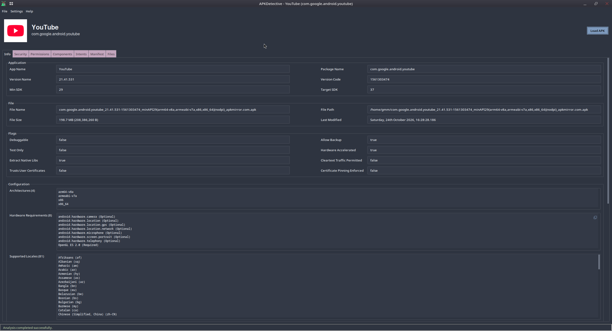</td>
    <td align="center"><b>Security</b><br>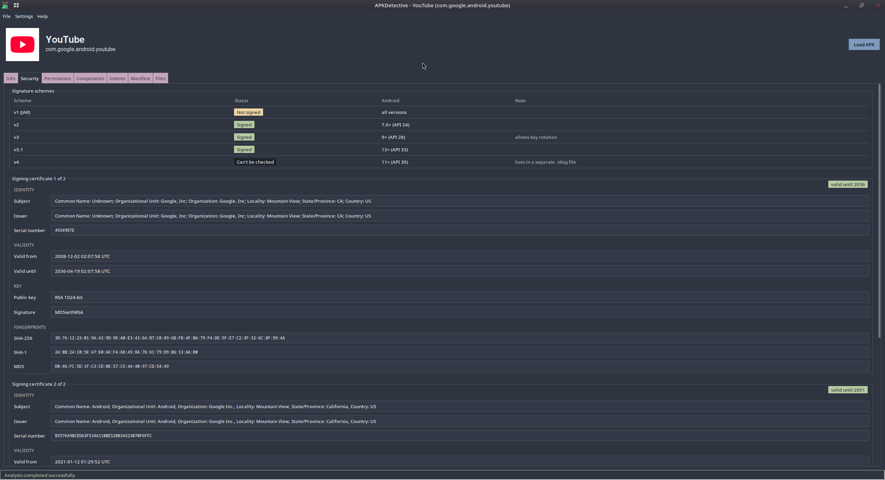</td>
  </tr>
  <tr>
    <td align="center"><b>Permissions</b><br>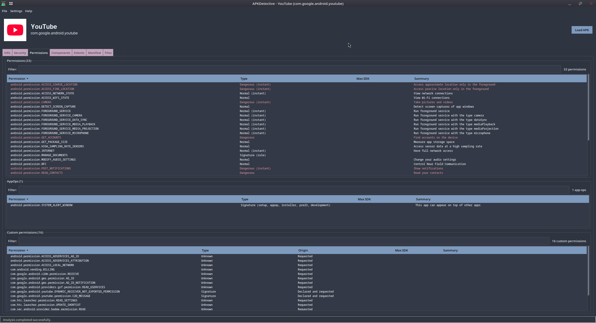</td>
    <td align="center"><b>Components</b><br>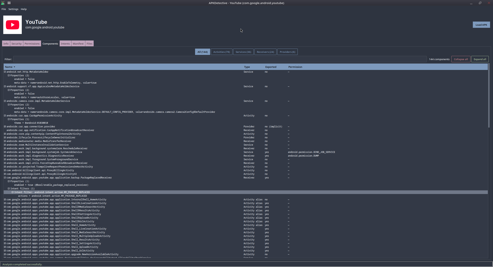</td>
  </tr>
  <tr>
    <td align="center"><b>Intents</b><br>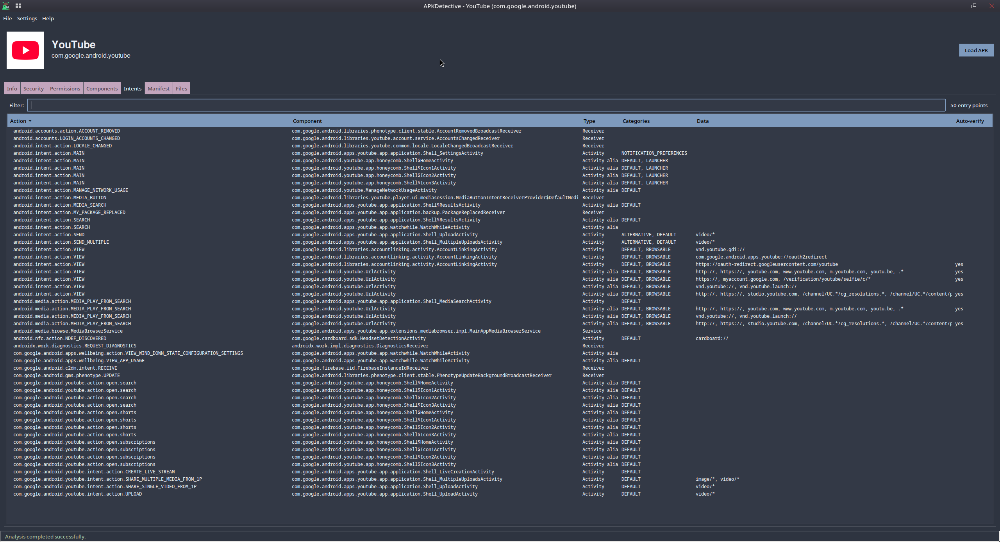</td>
    <td align="center"><b>Manifest</b><br>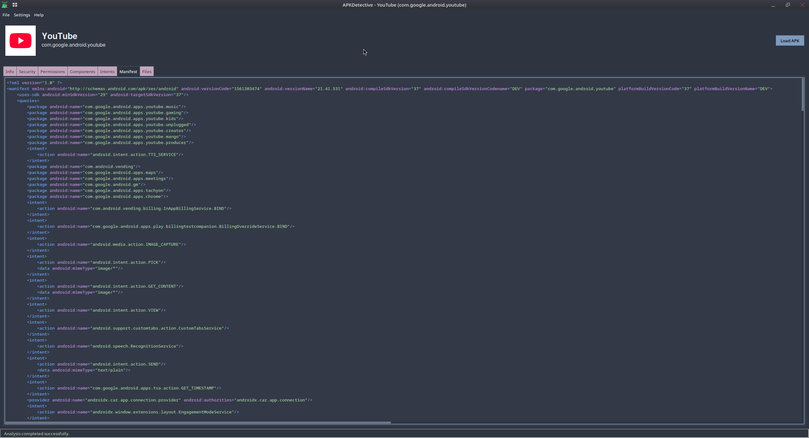</td>
  </tr>
  <tr>
    <td align="center"><b>Files</b><br>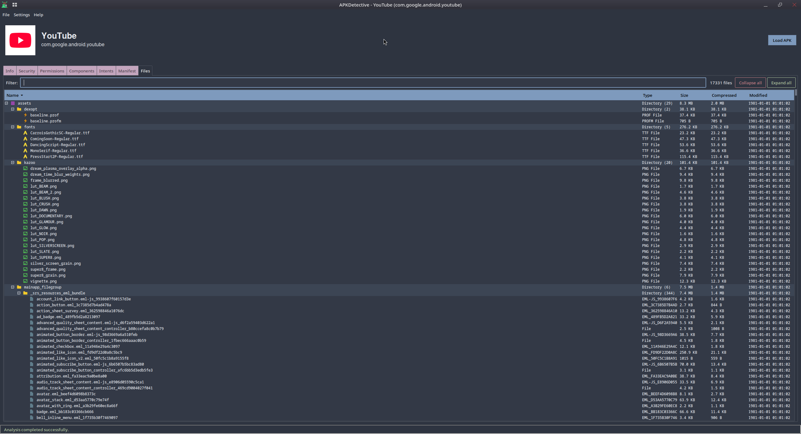</td>
    <td align="center"><b>Files: right-click menu</b><br>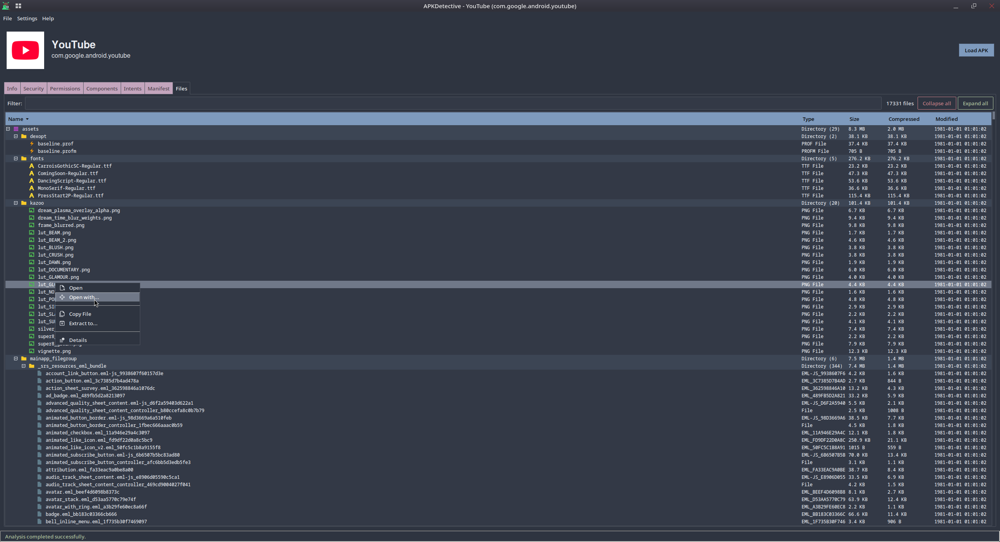</td>
  </tr>
  <tr>
    <td align="center"><b>Light mode</b><br>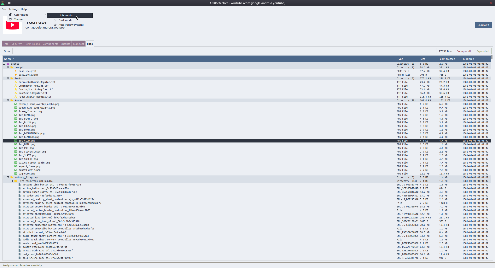</td>
    <td align="center"><b>Theme picker</b><br>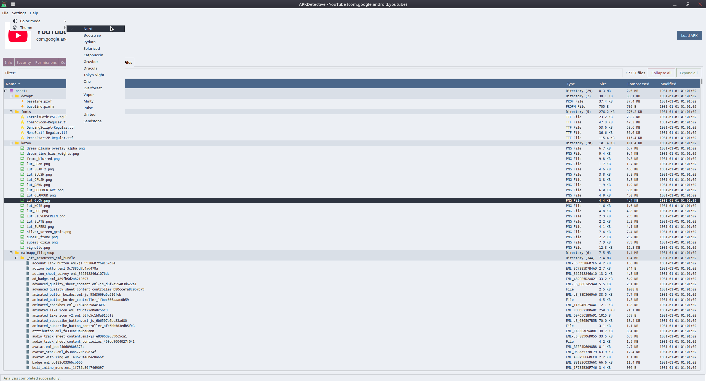</td>
  </tr>
</table>


## New to Android? A 2-minute glossary

You do not need to know any of this to use the app, but it explains what you are looking at.

| Word | In plain English |
|---|---|
| **APK** | The installable file of an Android app. Think of it as a `.zip` with a very specific structure. |
| **Package name** | The app's unique ID, e.g. `com.whatsapp`. Two apps can't share one. |
| **Manifest** | The app's "ID card and rulebook": its name, permissions and what it can do. |
| **Permission** | Something the app asks the user to allow (camera, location...). *Dangerous* ones touch private data. |
| **SDK / API level** | The Android version number. *Min SDK* = oldest Android it runs on, *Target SDK* = the version it was designed for. |
| **Component** | A building block of an app: a screen (*activity*), a background job (*service*), a listener for system events (*receiver*) or a data provider (*provider*). |
| **Exported** | Whether *other apps* are allowed to use that component. |
| **Intent** | A message used to start something: "open this link", "share this picture"... |
| **DEX** | The compiled code of the app (Android's version of a `.jar`). |
| **Signature / certificate** | A digital seal proving who published the app and that it was not tampered with. |
| **Fingerprint (SHA-256...)** | A short code that uniquely identifies a certificate. |
| **Tracker** | A bundled library that collects analytics or shows ads. |


## Architecture

APKDetective follows a **layered / hexagonal ("ports and adapters") architecture**. The goal: the rules of the
application never depend on a specific library or GUI toolkit, so each piece can be understood, tested and
replaced on its own.

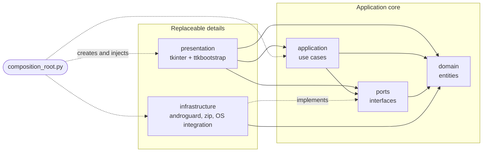

Solid arrows are imports (`X --> Y` means "X imports from Y"). Dotted arrows are wiring done at start-up.

### Layers

| Layer | Responsibility | May depend on |
|---|---|---|
| **Domain** | Pure data: `ApplicationInfo`, `Certificate`, `SecurityInfo`, `DexMetrics`, `FileNode`... | nothing |
| **Ports** | Interfaces for what the app needs from the outside world. | domain |
| **Application** | Use cases: analyze, export, extract, preview files. | domain, ports |
| **Infrastructure** | Real implementations of the ports: androguard, ZIP, OS integration. | domain, ports |
| **Presentation** | The GUI: window, menus, tabs, widgets and themes. | application, domain, ports |

The **dependency rule**: *dependencies point inwards*. The domain imports nothing from the other layers, and
`infrastructure` and `presentation` never import each other.

### Composition root

[`apkdetective/composition_root.py`](apkdetective/composition_root.py) is the **only** module that knows every layer.
It chooses a concrete implementation for each port and injects it where needed. Swapping the APK parser, the GUI
toolkit or the storage means editing that one file.

### How an APK flows through the app

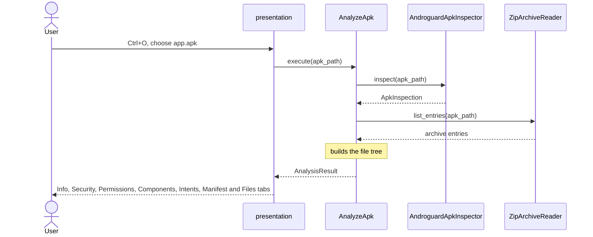

`AnalyzeApk` only knows `IN` and `AR` through their ports (`ApkInspectorPort` and `ArchiveReaderPort`);
`composition_root.py` decides which concrete classes are plugged in.

### Cross-platform support

Anything that depends on the operating system sits behind a port and has one implementation per OS, selected at
start-up by `PlatformServicesResolver`:

| Capability | Windows | Linux | macOS | Other |
|---|:---:|:---:|:---:|:---:|
| Detect the system light/dark mode | Yes | Yes | Yes | Defaults to light |
| Open a file with the default app | Yes | Yes (`xdg-open`) | Yes | No |
| "Open with..." | Yes | Yes (desktop portal, via `dbus-next`) | Yes | No |
| Copy a real file to the clipboard | Yes | Yes | Yes | No |

### Project layout

```text
APKDetective/
├── main.py                       # entry point
├── requirements.txt
├── apkdetective/
│   ├── composition_root.py       # wires every layer together
│   ├── domain/                   # entities (pure data)
│   ├── ports/                    # interfaces: apk, filesystem, formatting, system
│   ├── application/              # use cases: analysis, appearance, export, files
│   ├── infrastructure/           # androguard, appearance, clipboard, filesystem,
│   │                             #   os_integration, platforms, url, xml, zip
│   └── presentation/             # app, appearance, common widgets, config, formatting, header,
│                                 #   menu_bar, status_bar, tabs, viewmodels
├── utils/                        # developer helper scripts
└── .github/workflows/            # CI (lint + types) and release builds
```

### Code conventions

- **One class per file.**
- No layer reaches into another except through the rules above.
- No duplicated, unused or inconsistent code: every push is checked with **Pylint** and **mypy**
  on all three operating systems.
- UI components are shared as much as possible. For example, the *Files*, *Components* and *Intents* tabs are
  all built on the same table base (`BaseTreePanel`), which provides the filter, counter, sorting and
  expand / collapse behaviour.


## Tech stack

| Purpose | Library |
|---|---|
| GUI | [`tkinter`](https://docs.python.org/3/library/tkinter.html) + [`ttkbootstrap`](https://ttkbootstrap.readthedocs.io/) |
| APK / manifest / certificate parsing | [`androguard`](https://github.com/androguard/androguard) |
| XML handling | [`lxml`](https://lxml.de/) |
| Icons and images | [`Pillow`](https://python-pillow.org/) |
| Locale data | [`Babel`](https://babel.pocoo.org/) |
| Logging | [`loguru`](https://github.com/Delgan/loguru) |
| Linux "Open with..." | [`dbus-next`](https://github.com/altdesktop/python-dbus-next) *(Linux only)* |
| Packaging | [`Nuitka`](https://nuitka.net/) |


## Running from source

**Requirements**

- Python **3.10 or newer** with `tkinter`
  - Windows / macOS: included with the official Python installer.
  - Debian / Ubuntu: `sudo apt install python3-tk`
  - Fedora: `sudo dnf install python3-tkinter`

**Steps**

```bash
# 1. Get the code
git clone https://github.com/gmm96/APKDetective.git
cd APKDetective

# 2. (Recommended) create a virtual environment
python -m venv .venv
source .venv/bin/activate          # Windows: .venv\Scripts\activate

# 3. Install the dependencies
pip install -r requirements.txt

# 4. Run it
python main.py                     # empty window, then Ctrl+O
python main.py path/to/app.apk     # or open an APK directly
```


## Development

```bash
pip install pylint mypy
pylint main.py apkdetective/
mypy --explicit-package-bases --ignore-missing-imports main.py apkdetective/
```

The *Linting & Type Analysis* workflow runs Pylint and mypy on Linux, macOS and Windows for every push and pull
request (each OS skips the other platforms' OS-specific modules).

Helper scripts live in [`utils/`](utils).


## Contributing

Contributions are welcome: bug reports, ideas and pull requests alike.

1. **Found a bug or want a feature?** [Open an issue](https://github.com/gmm96/APKDetective/issues)
   (include the OS, the steps and, if you can, the kind of APK that triggered it).
2. **Want to change code?**
   1. Fork the repository and create a branch (`git checkout -b feature/my-idea`).
   2. Keep to the [architecture rules](#architecture): put logic in the right layer and respect *one class per file*.
   3. Make sure `pylint` and `mypy` pass.
   4. Open a pull request describing **what** changed and **why**.

> Please do not attach copyrighted or private APKs to issues. Share the package name or a public link instead.


## License

Distributed under the **GNU General Public License v3.0**. See [`LICENSE`](LICENSE) for the full text.


## Acknowledgements

- [androguard](https://github.com/androguard/androguard): the engine that makes reading APKs possible.
- [ttkbootstrap](https://github.com/israel-dryer/ttkbootstrap): modern themes for tkinter.
- [Bootstrap Icons](https://icons.getbootstrap.com/): the icon set.
- [Nuitka](https://nuitka.net/): compiling Python into standalone executables.
